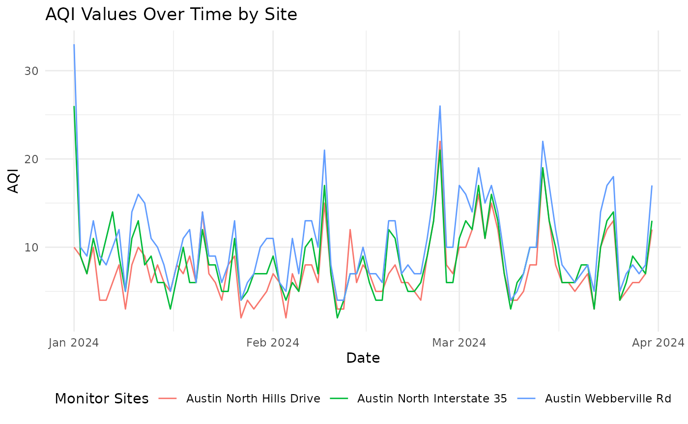

# AQI Demo

Below we will introduce Air Quality Index (AQI), and demonstrate how to
use tidyindex package to compute it based on existing datasets.

``` r
library(tidyindex)
library(dplyr)
library(purrr)
```

## Everything about AQI

The Air Quality Index (AQI) is an index created to measure air quality,
with high values indicating greater pollution levels. The index
categorized into six levels, each corresponding to a specific numerical
range:

- Good (0 - 50),
- Moderate (50 - 100),
- Unhealthy for Sensitive Groups (101 - 150),
- Unhealthy (151 - 200),
- Very Unhealthy (201 - 300), and
- Hazardous (300 and higher).

The AQI is calculated individually for each of the six major pollutants:
Ozone (O3), PM2.5, PM10, Carbon Monoxide (CO), Sulfur Dioxide (SO2),
Nitrogen Dioxide (NO2). The pollution concentrations are first
truncated, and then the AQI value for each pollutant is calculated based
on the following equation:

``` math
\text{I}_\text{p} = \frac{\text{I}_\text{Hi} - \text{I}_\text{Lo}}{\text{BP}_\text{Hi} - \text{BP}_\text{Lo}}(\text{C}_\text{p} - \text{BP}_\text{Lo}) + \text{I}_\text{Lo}.
```
where:

- $`\text{I}_\text{p}`$ is the AQI for pollutant $`\text{p}`$,

- $`\text{C}_\text{p}`$ is the truncated concentration of pollutant
  $`\text{p}`$,

- $`\text{BP}_\text{Hi}`$ and $`\text{BP}_\text{Lo}`$ are the high and
  low concentration breakpoints of $`\text{C}_\text{p}`$, which are
  provided in Table 6 of the [Technical Assistance Document for the
  Reporting of Daily Air
  Quality](https://document.airnow.gov/technical-assistance-document-for-the-reporting-of-daily-air-quailty.pdf).

- $`\text{I}_\text{Hi}`$ and $`\text{I}_\text{Lo}`$ are the AQI values
  corresponding to $`\text{BP}_\text{Hi}`$ and $`\text{BP}_\text{Lo}`$,
  respectively.

Each individual AQI value is rounded to the nearest integer, and the
highest value among the six pollutant is taken as the final AQI.

As an example, with an 8-hour measurement of CO value of 4.67, this
value is first truncate to 4.6. For CO concentrations ranging from 4.5
to 9.4, the corresponding AQI range is 51 to 100. Using the formula
above, the AQI is calculated as follows:

``` math
\frac{100 - 51}{9.4 - 4.5}\times(4.6 - 4.5) + 51 = 75.01,
```

This gives an AQI value of 75 for CO after rounding.

## Construct AQI with `tidyindex`

In this section, we will demonstrate how to compute the AQI using the
`tidyindex` package. The `aqi` data, available in the `tidyindex`
package, contains daily PM2.5 values recorded from January to March 2024
at three monitoring sites in Travis county, Texas, USA.

``` r
aqi
#> # A tibble: 272 × 9
#>    pollutant  code date       value   aqi  long   lat site_code site_name       
#>    <chr>     <dbl> <date>     <dbl> <int> <dbl> <dbl>     <dbl> <chr>           
#>  1 PM2.5     88101 2024-01-01  10      53 -97.8  30.4        14 Austin North Hi…
#>  2 PM2.5     88101 2024-01-02   9.1    51 -97.8  30.4        14 Austin North Hi…
#>  3 PM2.5     88101 2024-01-03   7.1    39 -97.8  30.4        14 Austin North Hi…
#>  4 PM2.5     88101 2024-01-04  10.3    53 -97.8  30.4        14 Austin North Hi…
#>  5 PM2.5     88101 2024-01-05   3.7    21 -97.8  30.4        14 Austin North Hi…
#>  6 PM2.5     88101 2024-01-06   4.5    25 -97.8  30.4        14 Austin North Hi…
#>  7 PM2.5     88101 2024-01-07   6.2    34 -97.8  30.4        14 Austin North Hi…
#>  8 PM2.5     88101 2024-01-08   7.5    42 -97.8  30.4        14 Austin North Hi…
#>  9 PM2.5     88101 2024-01-09   2.7    15 -97.8  30.4        14 Austin North Hi…
#> 10 PM2.5     88101 2024-01-10   7.5    42 -97.8  30.4        14 Austin North Hi…
#> # ℹ 262 more rows
```

### Augment low/high breakpoints

To compute the AQI, as outlined in Section 1, we must first determine
the high and low breakpoints for each sample measurement, as well as the
corresponding AQI breakpoints. The helper functions below are designed
to assist with retrieving this breakpoint information and augmenting
them into the `aqi` data.

``` r
lookup_helper <- function(sample, subset){
  return(subset %>% filter(sample >= low & sample <= high))
}

breakpoint_lookup <- function(dataset){
  # takes the dataset of measurements as input
  # returns a tibble object with corresponding breakpoints and group info
  id <- dataset$code[1]
  concentration <- dataset$value
  if(id == "44201"){
    concentration <- trunc(concentration * 10^3)/10^3
  }
  else if (id == "88101" | id == "42101"){
    concentration <- trunc(concentration * 10)/10
  }
  else{
    concentration <- trunc(concentration)
  }
  subset <- pollutant_ref_tbl %>% filter(code == id)
  results <- map_dfr(concentration, ~ lookup_helper(.x, subset)) %>%
    bind_cols(aqi |> select(-pollutant, -code))
  return(results)
}
```

The `lookup_helper()` function finds the high and low breakpoints for
any given samples. The `breakpoint_lookup()` function first truncates
each measurement based on the pollutant, then calls `lookup_helper()` to
augment the high/low breakpoints and group information.

``` r
(aqi_aug <- breakpoint_lookup(aqi))
#> # A tibble: 272 × 12
#>    pollutant  code group            low  high date       value   aqi  long   lat
#>    <chr>     <dbl> <chr>          <dbl> <dbl> <date>     <dbl> <int> <dbl> <dbl>
#>  1 PM2.5     88101 Unhealthy        9.1  35.4 2024-01-01  10      53 -97.8  30.4
#>  2 PM2.5     88101 Unhealthy        9.1  35.4 2024-01-02   9.1    51 -97.8  30.4
#>  3 PM2.5     88101 Very Unhealthy   0     9   2024-01-03   7.1    39 -97.8  30.4
#>  4 PM2.5     88101 Unhealthy        9.1  35.4 2024-01-04  10.3    53 -97.8  30.4
#>  5 PM2.5     88101 Very Unhealthy   0     9   2024-01-05   3.7    21 -97.8  30.4
#>  6 PM2.5     88101 Very Unhealthy   0     9   2024-01-06   4.5    25 -97.8  30.4
#>  7 PM2.5     88101 Very Unhealthy   0     9   2024-01-07   6.2    34 -97.8  30.4
#>  8 PM2.5     88101 Very Unhealthy   0     9   2024-01-08   7.5    42 -97.8  30.4
#>  9 PM2.5     88101 Very Unhealthy   0     9   2024-01-09   2.7    15 -97.8  30.4
#> 10 PM2.5     88101 Very Unhealthy   0     9   2024-01-10   7.5    42 -97.8  30.4
#> # ℹ 262 more rows
#> # ℹ 2 more variables: site_code <dbl>, site_name <chr>
```

*Note that to efficiently use the tidyindex pipeline, it is recommended
to put all needed data columns into one single dataframe or tibble
object.*

The construction of AQI can be divided into two steps:

- a minmax **rescaling** step:
  $`I_{rescaled} = \frac{\text{C}_\text{p} - \text{BP}_\text{Lo}}{\text{BP}_\text{Hi} - \text{BP}_\text{Lo}}`$
- a **variable transformation** step (affine transformation):
  $`(\text{I}_\text{Hi} - \text{I}_\text{Lo}) \times I_{rescaled} + \text{I}_\text{Lo}`$.

### Rescaling

The minmax rescaling is performed by the `rescaling` module and the
[`rescale_minmax()`](../reference/rescale.md) step requires `min` and
`max` argument, which correspond to the low and high breakpoints we’ve
looked up. The rescaled values are stored in the `minmax` column.

``` r
pipeline <- init(aqi_aug) |> 
  rescaling(minmax = rescale_minmax(value, min = low, max = high))

pipeline$data %>% dplyr::select(pollutant, date, low, high, value, minmax)
#> # A tibble: 272 × 6
#>    pollutant date         low  high value minmax
#>    <chr>     <date>     <dbl> <dbl> <dbl>  <dbl>
#>  1 PM2.5     2024-01-01   9.1  35.4  10   0.0342
#>  2 PM2.5     2024-01-02   9.1  35.4   9.1 0     
#>  3 PM2.5     2024-01-03   0     9     7.1 0.789 
#>  4 PM2.5     2024-01-04   9.1  35.4  10.3 0.0456
#>  5 PM2.5     2024-01-05   0     9     3.7 0.411 
#>  6 PM2.5     2024-01-06   0     9     4.5 0.5   
#>  7 PM2.5     2024-01-07   0     9     6.2 0.689 
#>  8 PM2.5     2024-01-08   0     9     7.5 0.833 
#>  9 PM2.5     2024-01-09   0     9     2.7 0.3   
#> 10 PM2.5     2024-01-10   0     9     7.5 0.833 
#> # ℹ 262 more rows
```

### Variable transformation

While an affine transformation step is not initially included in the
`tidyindex` package, you can always easily create one:

``` r
trans_affine <- function(var, a = NULL, b = NULL){
  fn <- function(x, a = NULL, b = NULL) a*x + b
  new_trans("trans_affine", var = enquo(var), 
            fn = fn, a = enquo(a), b = enquo(b))
}
```

The `trans_affine` function has three inputs:

- `var`, the variable to be transformed;
- `a`, the multiplicative coefficient, and
- `b`, the additive constant

The `fn` function specifies the transformation as `a*x + b`. The
`new_trans()` constructor is then called to register the name along with
other inputs, including the transformed variable, the transformation
function `fn`, and associated parameters `a` and `b`. This creates a
“recipe” for the transformation that can be evaluated standalone and
used in the
[`variable_trans()`](../reference/variable-transformation.md) module.

``` r
trans_affine(minmax, a = high - low, b = low)
#> [1] "trans_affine"
#> attr(,"var")
#> <quosure>
#> expr: ^minmax
#> env:  global
#> attr(,"fn")
#> function (x, a = NULL, b = NULL) 
#> a * x + b
#> <bytecode: 0x588c1dae0128>
#> <environment: 0x588c1dad7638>
#> attr(,"args")
#> attr(,"args")$a
#> <quosure>
#> expr: ^high - low
#> env:  global
#> 
#> attr(,"args")$b
#> <quosure>
#> expr: ^low
#> env:  global
#> 
#> attr(,"class")
#> [1] "var_trans"
```

*Note: the [`enquo()`](https://rlang.r-lib.org/reference/enquo.html)
function is required for additional parameters`a` and `b` in the
`new_trans()` constructor. This creates a defused expression that
describes how to evaluate the values but not actually execute the
evaluation. For more details, see
[`rlang::enquo()`](https://rlang.r-lib.org/reference/enquo.html)*

This concludes our pipeline for computing the AQI:

``` r
pipeline <- pipeline |> 
  variable_trans(AQI = trans_affine(minmax, a = high - low, b = low))
pipeline$data$AQI <- round(pipeline$data$AQI)
pipeline$data |> dplyr::select(pollutant, date, low, high, value, minmax, AQI)
#> # A tibble: 272 × 7
#>    pollutant date         low  high value minmax   AQI
#>    <chr>     <date>     <dbl> <dbl> <dbl>  <dbl> <dbl>
#>  1 PM2.5     2024-01-01   9.1  35.4  10   0.0342    10
#>  2 PM2.5     2024-01-02   9.1  35.4   9.1 0          9
#>  3 PM2.5     2024-01-03   0     9     7.1 0.789      7
#>  4 PM2.5     2024-01-04   9.1  35.4  10.3 0.0456    10
#>  5 PM2.5     2024-01-05   0     9     3.7 0.411      4
#>  6 PM2.5     2024-01-06   0     9     4.5 0.5        4
#>  7 PM2.5     2024-01-07   0     9     6.2 0.689      6
#>  8 PM2.5     2024-01-08   0     9     7.5 0.833      8
#>  9 PM2.5     2024-01-09   0     9     2.7 0.3        3
#> 10 PM2.5     2024-01-10   0     9     7.5 0.833      8
#> # ℹ 262 more rows
```

Now let’s check our results. Below we show a line graph with AQI values
from all three monitor sites, computed using our pipeline.

``` r
library(ggplot2)
pipeline$data$date <- as.Date(pipeline$data$date)
ggplot(pipeline$data, aes(x = date, y = AQI, color = site_name)) +
  geom_line() + 
  labs(title = "AQI Values Over Time by Site",
       x = "Date",
       y = "AQI",
       color = "Monitor Sites") +
  theme_minimal() +
  scale_x_date(date_labels = "%b %Y", date_breaks = "1 month") +
  theme(legend.position = "bottom")
```


