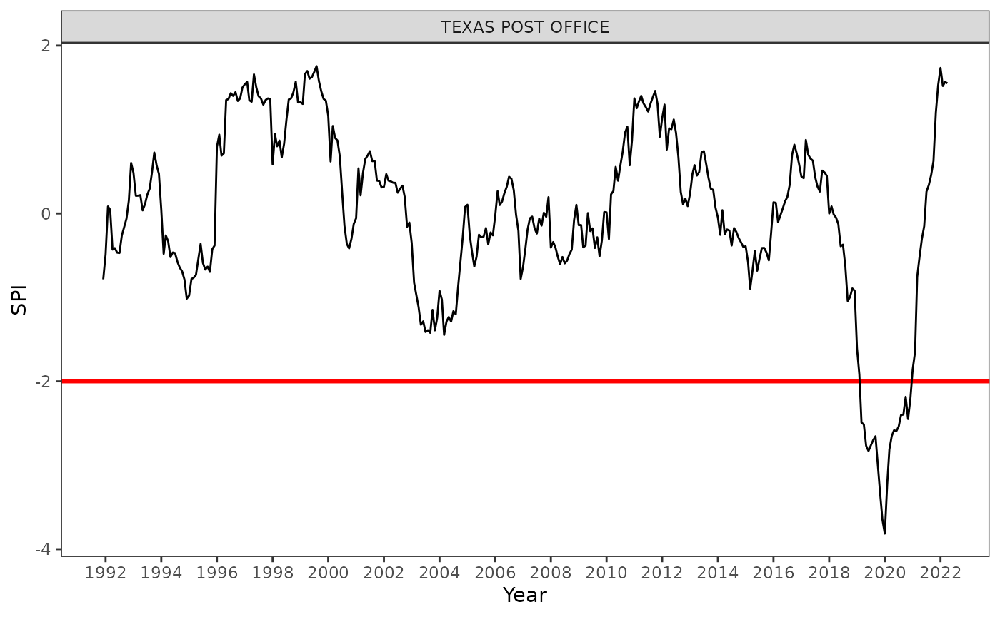

# tidyindex

``` r
library(tidyindex)
library(dplyr)
library(lubridate)
library(lmomco)
library(ggplot2)
library(tsibble)
```

The tidyindex package provides functionality to construct indexes in a
data pipeline, align with the tidyverse paradigm. The pipeline approach
is universally applicable to indexes of all kinds. It allows indexes to
be broken down into a set of defined building blocks (modules) and hence
provides means to standardise the workflow to construct, compare, and
analyse indexes.

### Decomposing an index into steps

Here we present an example to calculate one of the most widely used
drought index: Standardised Precipitation Index (SPI). The index is
composed to three steps:

- step 1: aggregate the precipitation series in a rolling window
- step 2: fit a distribution (usually gamma), per month, to the
  aggregated precipitation
- step 3: normalise the fitted values to a standard normal distribution
  as the index

### Pipeline design

These three steps correspond to three modules in the tidyindex pipeline
([`temporal_aggregate()`](../reference/temporal-aggregate.md),
[`distribution_fit()`](../reference/dist-fit.md), and
[`normalise()`](../reference/normalise.md)). Each module uses a
tidyverse-mutate style to calculate a step within the module. For
example, the following code fits a gamma distribution to the variable
`.agg`. Different distributions are available and prefixed with
`dist_*()` and additional distribution can be added by the user
following a similar style to the existing `dist_*()` steps. The step
`dist_*()` can also be evaluated standalone and seen as a recipe of the
step:

``` r
distribution_fit(.fit = dist_gamma(...))
```

``` r
dist_gamma(var = ".agg")
#> [1] "distfit_gamma"
#> attr(,"var")
#> <quosure>
#> expr: ^".agg"
#> env:  empty
#> attr(,"fn")
#> function (var_para, var_fit) 
#> {
#>     para <- do.call("pargam", list(do.call("lmoms", list(var_para))))
#>     var_fit2 <- var_fit[!is.na(var_fit)]
#>     fit <- do.call("cdfgam", list(x = var_fit2, para = para))
#>     n_padding <- length(var_fit) - length(fit)
#>     if (n_padding > 0) {
#>         fit <- c(rep(NA, n_padding), fit)
#>     }
#>     tibble(para = list(para), fit = list(fit))
#> }
#> <bytecode: 0x5c9c2b334370>
#> <environment: 0x5c9c2b332888>
#> attr(,"n_boot")
#> [1] 1
#> attr(,"boot_seed")
#> [1] 123
#> attr(,"dist")
#> [1] "gamma"
#> attr(,"class")
#> [1] "dist_fit"
```

### Standardised Precipitation Index (SPI): An example

Here we select a single station, Texas Post Office, where is heavily
impacted during the 2019/20 bushfire season, in Queensland, Australia,
to demonstrate the calculation.

``` r
texas_post_office <- queensland %>% 
  filter(name == "TEXAS POST OFFICE") %>% 
  mutate(month = lubridate::month(ym)) 

dt <- texas_post_office |>
  init(id = id, time = ym, group = month) |> 
  temporal_aggregate(.agg = temporal_rolling_window(prcp, scale = 24)) |> 
  distribution_fit(.fit = dist_gamma(var = ".agg")) |>
  tidyindex::normalise(.index = norm_quantile(.fit))
dt
#> Index pipeline: 
#> 
#> Steps:
#> temporal: `rolling_window()` -> .agg
#> distribution_fit: `distfit_gamma()` -> .fit
#> normalise: `norm_quantile()` -> .index
#> 
#> Data: 
#> # A tibble: 365 × 14
#>    id       month       ym  prcp  tmax  tmin  tavg  long   lat name   .agg  .fit
#>    <chr>    <dbl>    <mth> <dbl> <dbl> <dbl> <dbl> <dbl> <dbl> <chr> <dbl> <dbl>
#>  1 ASN0004…    12 1991 Dec  1340  31.7 16.1   23.9  151. -28.9 TEXA… 10807 0.216
#>  2 ASN0004…     1 1992 Jan  1732  34.4 18.5   26.5  151. -28.9 TEXA… 11699 0.313
#>  3 ASN0004…     2 1992 Feb  1850  31.2 19.2   25.2  151. -28.9 TEXA… 13091 0.533
#>  4 ASN0004…     3 1992 Mar   146  31.0 14.1   22.6  151. -28.9 TEXA… 13081 0.518
#>  5 ASN0004…     4 1992 Apr   324  27.2 12.6   19.9  151. -28.9 TEXA… 11876 0.333
#>  6 ASN0004…     5 1992 May   597  22.0  9.12  15.6  151. -28.9 TEXA… 11861 0.340
#>  7 ASN0004…     6 1992 Jun    76  18.6  2.49  10.5  151. -28.9 TEXA… 11775 0.320
#>  8 ASN0004…     7 1992 Jul   100  19.8  1.73  10.8  151. -28.9 TEXA… 11735 0.319
#>  9 ASN0004…     8 1992 Aug   578  20.8  4.01  12.4  151. -28.9 TEXA… 12213 0.397
#> 10 ASN0004…     9 1992 Sep   416  22.8  6.41  14.6  151. -28.9 TEXA… 12439 0.436
#> # ℹ 355 more rows
#> # ℹ 2 more variables: .fit_obj <list>, .index <dbl>
```

The results contain a summary of the steps used and the data with
intermediate variables (`.agg`, `.fit`, and `.fit_obj`) and the index
(`.index`). We can plot the result using `ggplot2` as:

``` r
dt$data |> 
  ggplot(aes(x = ym, y = .index)) + 
  geom_hline(yintercept = -2, color = "red",  linewidth = 1) + 
  geom_line() + 
  scale_x_yearmonth(name = "Year", date_break = "2 years", date_label = "%Y") +
   theme_bw() +
  facet_wrap(vars(name), ncol = 1) + 
  theme(panel.grid = element_blank(), 
        legend.position = "bottom") + 
  ylab("SPI")
```



## What’s more

There are many different things you can do with the package, for
example:

- to switch from SPI to Standardized Precipitation-Evapotranspiration
  Index (SPEI), simply add an variable transformation step to compute
  evapotranspiration from temperature data:
  `variable_trans(.pet = trans_thornthwaite(.tavg = tavg, .lat = lat))`
- a set of existing drought indexes are available as
  [`idx_spi()`](../reference/drought-idx.md),
  [`idx_spei()`](../reference/drought-idx.md),
  [`idx_edi()`](../reference/drought-idx.md), and
  [`idx_rdi()`](../reference/drought-idx.md)
- to compute multiple indexes at once, check
  [`compute_indexes()`](../reference/compute-idx.md)
- to calculate parameter uncertainty with the distribution fit, check
  the `.n_boot` argument in the
  [`distribution_fit()`](../reference/dist-fit.md)
